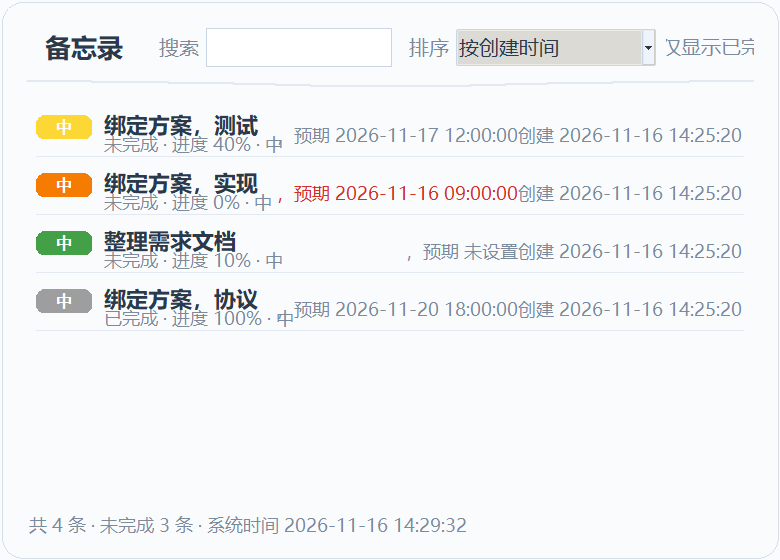
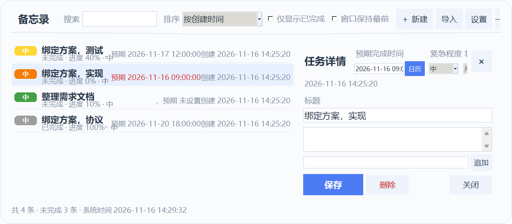

# 备忘录工具（Windows 桌面版）

<div align="center">
  
</div>

一个用 Python 3.9 标准库开发的 Windows 桌面备忘录程序，可打包为单文件 `exe`。
**运行时零第三方依赖**：系统托盘、解锁监听、气泡提醒全部通过 `ctypes` 直调 Win32 API 实现。

## 界面展示

**主界面**（搜索、排序、快捷筛选、彩色紧急度标签、逾期红字提醒）：



**详情面板**（双击任务右侧展开：属性编辑、历史进展、保存/删除）：



---

## 一、快速开始

> 重要：默认的 `python` 指向 WorkBuddy 内置 Python 3.13（无 tkinter），**不能**用于本项目。
> 请使用带 tkinter 的系统 Python 3.9。

```bat
:: 方式 1：py 启动器
py -3.9 main.py

:: 方式 2：绝对路径
C:\Users\laicong\AppData\Local\Programs\Python\Python39\python.exe main.py
```

启动后窗口**默认最小化到右下角系统托盘**，不会直接弹出主窗口。

### 托盘操作

| 操作 | 效果 |
| --- | --- |
| 左键单击 / 双击托盘图标 | 显示主窗口 |
| 右键托盘图标 → 显示主窗口 | 显示主窗口 |
| 右键 → 新建事务 | 显示主窗口并展开标题输入框 |
| 右键 → 退出 | 真正退出程序（保存数据） |

窗口上的 `×` / `—` 按钮**只隐藏到托盘，不退出程序**。需要退出请用托盘菜单「退出」，
或「设置」窗口里的「退出程序」按钮。

### 全局快捷键（快捷呼出）
按 **F2**（默认，可在「设置 → 快捷键」修改）在「弹出 / 最小化」之间切换主窗口：
- 支持组合键，如 `Ctrl+Alt+M`、`Ctrl+Shift+F9`，输入框会实时校验并提示；
- 若所选按键已被其他程序占用（如 F1/F2 常被截屏工具占用），启动时会弹气泡
  提示注册失败，请在设置里换一个按键；
- 修改后点「保存设置」立即生效，无需重启。

### 窗口拖动与调整大小
- 按住**顶部任意空白区域**（标题两侧、分隔弧线、底部状态栏空白）即可拖动窗口；
- 把鼠标移到**窗口边缘**（8px 热区）光标会变成对应方向的调整箭头，
  按住拖动可向 8 个方向自由调整窗口大小（最小 480×320，不会超出屏幕）。

---

## 二、功能说明

### 主界面（浅色圆角卡片）
- 顶部：**搜索**（按标题 / 内容实时过滤）、**排序**（按创建时间 / 预期完成时间 / 紧急程度）、
  `＋ 新建`、`设置`、`—`、`×`。
- 顶部下方一条**圆角分隔弧线**。
- 事务列表每行：左侧一个**彩色标签**（显示紧急程度），中间标题与「状态 · 进度 · 紧急程度」，
  右侧显示 **「创建 时间，预期 时间」**，行间有横线分隔。
- 底部状态栏显示「共 N 条 · 未完成 M 条 · 系统时间 …」，系统时间每秒刷新。

### 新建事务（只需标题）
点击 `＋ 新建`（或托盘右键「新建事务」）后，顶部只展开**一行标题输入框**：
输入标题后按回车 / 点「确定」即创建并入库，按 Esc / 「取消」放弃。

新建时自动写入创建时间，其余字段一律使用默认值：

| 字段 | 新建时的值 |
| --- | --- |
| `created_at` | 本机系统时间（自动生成，只读） |
| `urgency` | 中 |
| `status` | 未完成 |
| `progress` | 0 |
| `due_at` / `content` / `logs` | 空 |

标题为空不会创建，不会弹窗打断操作。
**新建不会展开右侧详情**；要补充其它信息，双击列表中该行即可。

### 单实例运行
程序通过命名互斥体保证**同一时刻只运行一个实例**：再次双击 exe（或重复启动）
不会开第二个窗口，而是自动把已运行实例的主窗口唤起到前台
（窗口藏在托盘时会先恢复显示）。

### 事务字段
| 字段 | 说明 |
| --- | --- |
| `id` | 自动生成唯一标识 |
| `title` / `content` | 标题、备注正文（详情面板不展示，保存时原样保留） |
| `created_at` | **创建时间，新增时自动写入本机系统时间，不可手填** |
| `due_at` | 预期完成时间（可选，留空表示未设置） |
| `urgency` | 紧急程度：高 / 中 / 低 |
| `status` | 状态：未完成 / 已完成 |
| `progress` | 进度 0-100 |
| `logs` | 多条进展记录，每条自动带系统时间戳；详情面板按时间倒序展示 |

### 标签配色（可配置）
颜色由 **紧急程度 + 预期完成时间 + 状态** 两个（加状态共三个）维度共同判定，
默认映射关系如下，且**全部可以在「设置 → 配色与规则」里改**：

| 类别 | 判定条件 | 默认颜色 |
| --- | --- | --- |
| `done` 已完成 | 状态 = 已完成 | 灰 `#9E9E9E` |
| `overdue_high` 逾期·高紧急 | 已逾期 且 紧急程度=高 | 红 `#D32F2F` |
| `overdue` 已逾期 | 已逾期 | 橙 `#F57C00` |
| `urgent_high` 高紧急 | 未逾期 且 紧急程度=高 | 橙黄 `#F9A825` |
| `due_soon` 临期 | 距预期完成时间 ≤ 临期阈值（默认 48 小时） | 黄 `#FDD835` |
| `normal` 普通 | 其它 | 绿 `#43A047` |

「设置」窗口里可以：
- 为每个类别从预设颜色下拉中挑选，或直接填写任意 `#RRGGBB`；
- 修改「临期阈值（小时）」；
- 修改「默认排序」；
- 设置「快捷呼出」全局快捷键（见上文）；
- 点击「恢复默认」还原；点击「保存设置」立即生效并写盘。

配置文件：`data/config.json`（首次启动自动生成）。
也可以手工编辑该文件后重启程序，例如：

```json
{
  "version": 1,
  "color_map": {
    "done": "#9E9E9E",
    "overdue_high": "#D32F2F",
    "overdue": "#F57C00",
    "urgent_high": "#F9A825",
    "due_soon": "#FDD835",
    "normal": "#43A047"
  },
  "due_soon_hours": 48,
  "sort_mode": "created_at",
  "hotkey": "F2"
}
```

### 双击任务 → 右侧详情面板
新建时未填的其它信息都在这一步补：双击列表任意一行，窗口**右侧展开详情面板**，分成左右两栏：

| 区域 | 内容 |
| --- | --- |
| 左侧编辑区 | 标题、**历史进展**（按时间戳倒序，最近更新在最前，占满编辑区主体）、写进展输入框 |
| 右侧属性区 | 四个属性**一字排开**（标签在上、选择控件在下）：**预期完成时间**（点「日历」弹出月历，也可直接输入）、**紧急程度**下拉框、**状态**下拉框、**进度**步进框 |

- **历史进展**：占满左侧主体区域，每行格式为
  `2026-11-16 10:02:59：进展内容`（时间戳灰色弱化），最近一次记录在最上面。
  备注正文（`content` 字段）不在面板中显示，保存时原样保留。
- **写进展**：在底部输入框打字后按**回车**即记录一条，自动附加本机系统时间戳；
  也可以点「追加」按钮。新记录立刻出现在最上方。
- **预期完成时间**：点右侧「日历」按钮弹出月历，可切换上 / 下月、填写可选的 `HH:MM`、
  点「今天」快速选择、点「清除」取消设置；选中后写入 `YYYY-MM-DD` 或
  `YYYY-MM-DD HH:MM:SS`。输入框也支持直接手输（含 `YYYY/MM/DD` 斜杠格式），
  留空表示未设置，非法格式保存时会有提示。
- 紧急程度与状态是**只读下拉框**（高 / 中 / 低、未完成 / 已完成），进度用数字框填写。
  改动要点「保存」才写盘；「删除」有二次确认，「关闭」只收起面板。

> 展开详情时窗口自动加宽；屏幕较窄时窗口宽度会被限制在屏幕内，列表区相应变窄，
> 右侧属性区不会被裁掉。

### 每次解锁屏幕提醒
程序通过 `WTSRegisterSessionNotification` 注册隐藏消息窗口，收到
`WM_WTSSESSION_CHANGE` 且 `wParam == WTS_SESSION_UNLOCK (0x8)` 时，
统计未完成事务数并弹出**托盘气泡**：

```
标题：备忘录 · 解锁提醒
内容：还有 N 条未完成事务
```

同时刷新主窗口状态栏提示。实现说明见 `docs/实现说明.md`。
（启动成功后也会弹一次气泡，便于确认托盘已就绪。）

### 数据持久化
`data/memos.json`（标准库 `json`），所有时间戳一律取本机 `datetime.now()`，
不使用 UTC、不硬编码。可用环境变量 `MEMO_DATA_DIR` 指定其它数据目录。

打包后的 exe 优先在 **exe 同级 `data/`** 读写；若该位置不可写（例如 exe 被放进
`C:\Program Files\` 或只读 U 盘），会自动回退到 `%APPDATA%\PyMemoTool\`。
因此单文件 exe 拷到任何位置都能直接运行，不需要在旁边放任何依赖文件。

---

## 三、打包成 exe

```bat
build.bat
```

或

```bat
py -3.9 build.py
```

两者都明确调用系统 Python 3.9 的 PyInstaller，等价于：

```bat
py -3.9 -m PyInstaller --onefile --noconsole --clean --name MemoTool main.py
```

产物：`dist/MemoTool.exe`（单文件，约 8 MB）。打包后数据文件写在 **exe 同级目录的 `data/`** 下。

### 无依赖说明

`dist/MemoTool.exe` 是**自包含单文件**，只复制这一个文件到任意目录即可双击运行：

- 包内已内嵌 `python39.dll`、`VCRUNTIME140.dll`、`tcl86t.dll` / `tk86t.dll`、
  `_tkinter.pyd` 及 Tcl/Tk 数据文件，目标电脑**无需安装 Python、VC++ 运行库或任何第三方库**；
- PE 静态导入只有 `USER32 / COMCTL32 / KERNEL32 / ADVAPI32 / GDI32` 五个 Windows 系统 DLL；
- 运行时只会在自己旁边创建 `data/` 目录，不依赖工程目录里的源码、脚本或配置文件。

> 注意：`--noconsole` 下没有控制台输出；若打包或运行异常，可临时去掉
> `--noconsole` 重新打包以便查看报错。

---

## 四、目录结构

```
备忘录工具/
├── main.py              入口：装配主窗口、托盘、解锁监听
├── models.py            数据模型、枚举常量、系统时间工具
├── storage.py           JSON 持久化、增删改查、搜索排序、未完成计数
├── config.py            颜色映射规则 + 可配置读写 + 配色计算
├── theme.py             浅色主题常量（避免 UI 模块循环 import）
├── ui_main.py           主窗口：圆角卡片、搜索/排序、自绘列表、设置入口
├── ui_detail.py         右侧详情面板：左编辑区 + 右属性区、历史进展直接融进备注区
├── calendar_picker.py   日历形式的预期完成时间选择器（纯标准库）
├── single_instance.py   命名互斥体单实例守卫 + 唤起已开窗口
├── tray.py              ctypes Win32 托盘图标、气泡、右键菜单、消息循环
├── session_watcher.py   ctypes WTS 会话解锁监听
├── build.py             PyInstaller 打包脚本（含图标注入）
├── build.bat            Windows 一键打包批处理
├── requirements.txt     依赖说明（运行时零依赖）
├── assets/              应用图标（icon_master.png / memotool.ico / icon.png）
├── README.md            本文件
└── docs/
    ├── 实现说明.md       实现阶段说明文档
    └── images/          README 界面截图
```

---

## 五、兼容性与限制

- 目标环境：Windows + Python 3.9（语法严格兼容 3.9，不含 `match`、`X | Y`、3.10+ 特性）。
- 非 Windows 平台：`models` / `storage` / `config` / `theme` 可独立 import 用于测试；
  `tray` / `session_watcher` 也能安全 import，但托盘与解锁监听不可用，程序降级为普通窗口模式。
- 圆角窗口使用 `-transparentcolor` 键色实现，极个别系统主题下可能退化为直角（不影响功能）。
- 应用图标：`assets/memotool.ico`（打包时经 PyInstaller `--icon` 内嵌 exe，窗口与托盘共用；
  图标与 32px PNG 由 `assets/icon_master.png` 生成）。
- 气泡提醒依赖 Windows 通知区域允许显示气泡；若系统开启了「专注助手 / 勿扰模式」，
  气泡可能被系统折叠，此时主窗口状态栏仍会显示提示。
